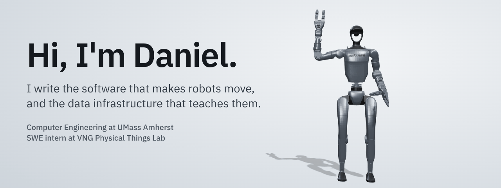
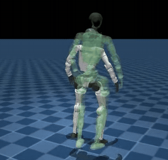
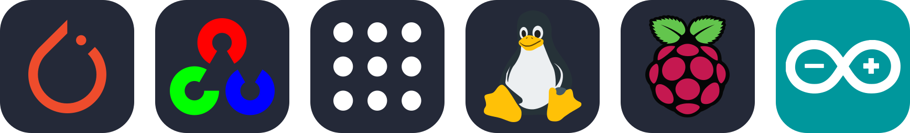
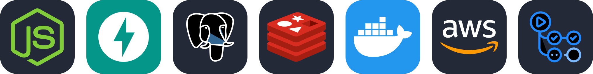

  <a href="https://www.linkedin.com/in/trkang"><b>LinkedIn</b></a>
  &nbsp;&nbsp;|&nbsp;&nbsp;
  <a href="https://olus.sh"><b>olus.sh</b></a> (live demo)

Right now
Training humanoid policies and building robot-data infrastructure at VNG's Physical Things Lab
Cut teleoperation latency on a 15-DoF robot hand from 65 ms to 25 ms (p95)
Looking for summer 2027 internships in robotics software and infrastructure
Projects
<table>
  <tr>
    <td width="40%" valign="top">
      
    </td>
    <td valign="top">
      <h3><a href="https://github.com/mizuharaa/g1-dance-studio">g1-dance-studio</a></h3>
      
Turns a dance video into a live Unitree G1 performance: motion extraction, RL training in sim, and safety-gated deployment on the real robot.

      

        <code>3 untethered runs on hardware</code>
        <code>50 Hz ONNX control</code>
        <code>4,096 parallel MuJoCo Warp envs</code>
      

      
Clip: a sim rollout of the trained policy, with the reference dance it follows shown in green.

    </td>
  </tr>
</table>
<table>
  <tr>
    <td width="33%" valign="top">
      <h4><a href="https://github.com/mizuharaa/player-one">player-one</a></h4>
      
Collects first-person video for robot training and pays collectors per reviewed minute. Collector app, review console, settlement.

      <code>500 concurrent users</code>
      <code>29 fault-injection scenarios</code>
      <code>SHA-256 verified uploads</code>
    </td>
    <td width="33%" valign="top">
      <h4><a href="https://github.com/mizuharaa/wisp_os">wisp_os</a></h4>
      
Approval queue, audit trail, and memory for long-running Claude Code and Codex agents.

      <code>parallel DAG scheduling</code>
      <code>crash recovery</code>
      <code>ranked memory retrieval</code>
    </td>
    <td width="33%" valign="top">
      <h4><a href="https://github.com/mizuharaa/olus">olus</a></h4>
      
Simulates airline disruptions and compares recovery plans built with OR-Tools CP-SAT. Live at <a href="https://olus.sh">olus.sh</a>.

      <code>185+ req/s at 50 VUs (k6)</code>
      <code>p95 under 450 ms</code>
      <code>111 tests</code>
    </td>
  </tr>
</table>
Also on here: SeroAI, a local-first deepfake detector, and Nexus, which turns a GitHub repo into a feature map an agent can build from.
Stack
<table>
  <tr>
    <td><b>Robots and ML</b></td>
    <td> plus MuJoCo Warp, ONNX, MediaPipe, inverse kinematics, Unitree G1, PaXini DexH15</td>
  </tr>
  <tr>
    <td><b>Backend and infra</b></td>
    <td> plus Fastify, S3-compatible storage, k6, Playwright</td>
  </tr>
  <tr>
    <td><b>Languages and apps</b></td>
    <td> plus React Native, Expo, SQL, pytest</td>
  </tr>
</table>
The waving robot is Unitree's G1 model (<a href="https://github.com/unitreerobotics/unitree_ros">unitree_ros</a>, BSD-3-Clause), posed and rendered with three.js. Icons from <a href="https://github.com/tandpfun/skill-icons">skill-icons</a> (MIT).
